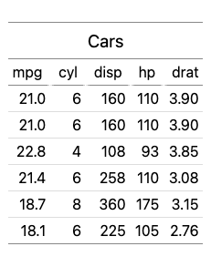

`lt_export()` saves a table as `.html`, `.pdf`, or `.png`. It needs Node.js or a headless Chromium-based browser for PDF and PNG; the chunk is skipped where neither is available.

```{r}
library(lt)
tbl = lt(head(mtcars[, 1:5], 2)) |> lt_header("Cars")
can_export = lt:::can_bake()
```

```{r, eval = can_export}
lt_export(tbl, "cars.png", width = "min-content")
lt_export(tbl, "cars.pdf")
```

:::: {#fig:export-png .figure}


::: caption
[ ](#@fig:export-png) A table exported to PNG.
:::
::::

:::: {#fig:export-pdf .figure}
<embed src="cars.pdf" type="application/pdf" width="100%" height="300">

::: caption
[ ](#@fig:export-pdf) A table exported to PDF.
:::
::::

A static `<table>`, with no JavaScript needed to view it, is one more option:

```{r, eval = can_export, attr.output = ".html"}
lt_export(tbl, NA, fragment = TRUE, css = FALSE, tidy = TRUE)
```
